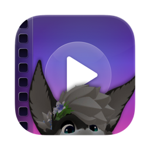
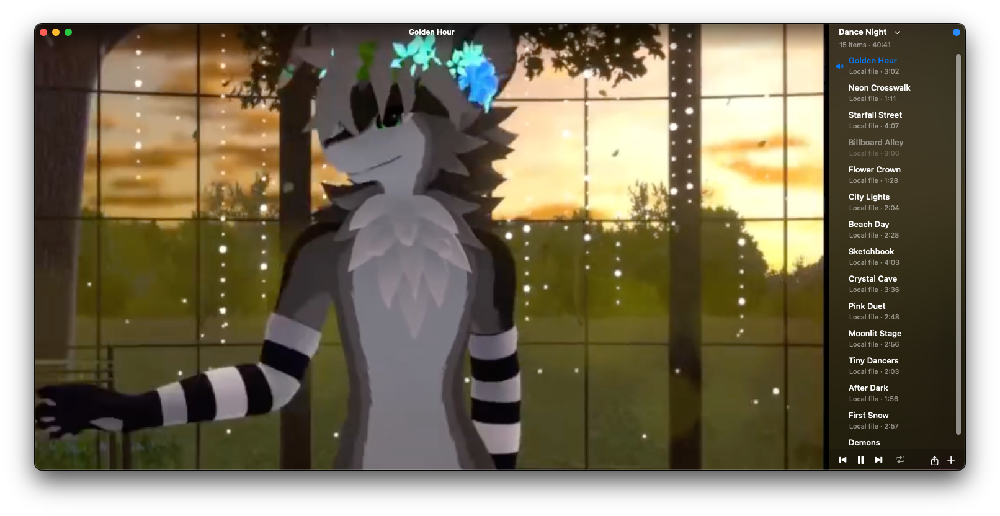
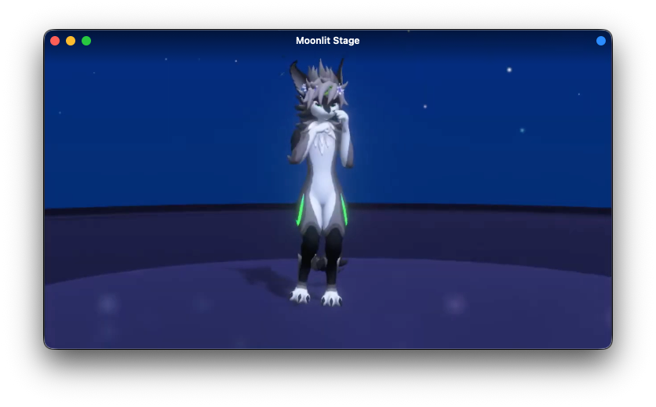
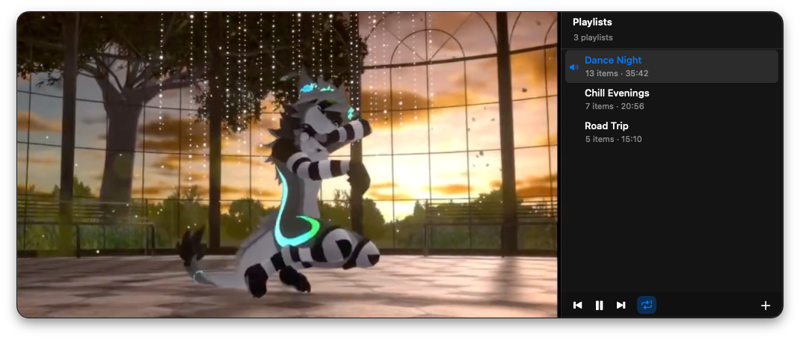

<div align="center">



# Reel

**A tiny, always-on-top video player for macOS.**<br>
Playlists, YouTube, transparent video and Liquid Glass, in a window that gets out of your way.

[](https://github.com/kaioker/reel/releases/latest)


[](https://github.com/kaioker/reel/releases)

### [⬇&nbsp; Download Reel for Mac](https://github.com/kaioker/reel/releases/latest/download/Reel.zip)

<sub>Free · ~10 MB · nothing else to install · updates itself</sub>

<br>



</div>

## Why Reel

Most players want to be the main window. Reel is built to sit in a corner while you do something else.

- **All video, no chrome.** The picture fills the whole window, title bar included. Controls appear only while the mouse moves.
- **Shrinks small, stays put.** Resize it far smaller than most players. It keeps the video's shape, and parked in a screen corner it stays there when the next video is a different shape.
- **Always on top** by default (⌘T to turn off), so it never slides behind your other apps.
- **Hotkeys while hovering.** Optionally, Reel's keys work with the mouse over it even while you're typing in another app.
- **Picks up where you left off.** Reopen Reel and it's on the same track at the same spot, paused.

<div align="center">

</div>

## Plays almost anything

| Source | Notes |
|---|---|
| **Files** | Video and audio files, whole folders. Audio-only tracks show a waveform. |
| **Links** | Direct video links and HLS streams |
| **YouTube** | Videos and whole playlists (Reel asks: play without saving, save as a new playlist, add the videos to the one you're viewing, or only this video) |
| **Bilibili** | Videos |
| **WebM, including transparent** | See-through video floats over your desktop, with glass behind it only while the playlist or window buttons show |
| **Unusual formats** | Anything macOS can't decode plays through Reel's built-in FFmpeg decoder, using the Mac's video hardware where it can. No conversion and no extra installs. |

### Watching

- **Subtitles,** off until you pick some: `.srt`, `.vtt` and `.ass` files named like the video, subtitles inside MKV
  and MP4 files (including picture subtitles from Blu-ray and DVD rips) and YouTube's captions, all in
  Playback → Subtitles. Reel remembers your choice for each track. Drop a subtitle file on the video to use it.
- **Audio tracks:** switch language or commentary in files that have more than one.
- **Speed** from ¼× to 2× with pitch kept natural, and **frame-by-frame** stepping.
- **Long videos pick up where you stopped,** even after playing other things in between.
- **AirPlay** to a TV or speakers, from either right-click menu.

Drop something on the video to play it right away, or on the playlist to add it at that spot. Dragging over the
video opens the playlist so you can. ⌘V works the same way, going wherever the pointer is. Anything playing that isn't
in a playlist gets an **Add** button, so you can keep it.

Reel can also be your **default video and music player** (Reel → Default Video Player / Default Music Player), so
double-clicking a file in Finder opens it in Reel.

## Playlists

<div align="center">

</div>

- A collapsible playlist slides out beside the video (⌘P, or the blue dot next to the window buttons). Opening it
  always shows what's playing.
- As many playlists as you like. Click the playlist's name, or swipe sideways with two fingers, to slide over to
  all of them. Picking one shows it without interrupting what's playing. ⌘↑ / ⌘↓ switch from the keyboard.
- Right-click a playlist to rename, export, show in Finder, clear or delete it. Drag to reorder.
- Each playlist is saved as a `.reel` file in `~/Library/Application Support/Reel/Playlists`, easy to back up or copy.
- **Shuffle**, per-track loop, play next, rename, and **skip**: struck-through tracks stay in the list, but playback
  passes over them. Playlists play through and round to the top; loop a track with L.
- **Search** as you type, and **sort** by title or length (⌘Z undoes it).
- **Stop after this track**, from the Playback menu.
- **Share playlists as `.reel` files.** Export one and send it to a friend. Double-clicking it plays it straight away
  without adding it to their playlists; they click **Save** if they want to keep it. Dropping one on Reel asks
  whether to play it without saving, save it, or add its items to the playlist you're viewing.

## Controls

| Input | Action |
|---|---|
| Click the video | Play / pause, and brings Reel forward |
| Double-click | Full screen |
| Space | Play / pause |
| ← → | Back / forward 10 seconds |
| ↑ ↓ or ⌘← ⌘→ | Previous / next track |
| ⌘↑ ⌘↓ | Previous / next playlist |
| L · S · M · F | Loop track · shuffle · mute · full screen |
| [ · ] · = | Slower · faster · normal speed (¼× to 2×) |
| , · . | One frame back · forward |
| V | Subtitles on / off |
| Right-drag ← → / ↑ ↓ | Seek / volume (or two-finger swipe; mouse wheel is volume) |
| Right-click | Quick menu. The video and a playlist track share the same track icons (play, loop, shuffle, skip, rename, Finder, AirPlay); then the video adds speed / audio / subtitles, on top, playlist, add, paste, full screen |
| Two-finger swipe ← → on the playlist | Slide between the playlist and all playlists |
| ⌘V | Paste links or files where the pointer is: into the playlist, or onto the video to play now |
| ⌘F | Search the playlist |
| ⌘P · ⌘T · ⌘0 | Playlist · always on top · actual size |
| Headset, AirPods, ⏯ ⏭ ⏮ keys | Play / pause, next and previous track; Reel shows in Control Center's Now Playing |

The full list is in **Help → Reel Help** (⌘?).

## Install

1. [Download Reel.zip](https://github.com/kaioker/reel/releases/latest/download/Reel.zip) and open it.
2. Drag **Reel** into your **Applications** folder.
3. Open Reel. Reel isn't from the App Store, so the first time macOS asks whether to trust it.
   Go to **System Settings → Privacy & Security**, scroll down, and click **Open Anyway** next to Reel.
   You only need to do this once.

Or install from Terminal:

```sh
curl -fsSL https://raw.githubusercontent.com/kaioker/reel/main/install.sh | zsh
```

**Requirements:** a Mac with Apple Silicon (M1 or later) running macOS 13 Ventura or later.
Liquid Glass styling appears on macOS 26 Tahoe; earlier versions get a frosted look instead.

### Updates

Reel checks for a new version each time it starts and offers to install it. It updates in place and comes
back on the same track and spot. You can also check any time with **Reel → Check for Updates…**

## Privacy

Reel has no accounts, ads or analytics. It talks to the internet only to play the links you give it and to check
GitHub for updates.

<details>
<summary><b>Build from source</b></summary>

<br>

Needs the Swift toolchain (Xcode or the Command Line Tools); nothing else to install. The first build downloads
the official FFmpeg and libvpx sources and builds them for macOS 13 and later (cached; rebuilt only when their
versions or options change).

```sh
./build.sh            # builds Reel.app here
./build.sh --install  # …and copies it to /Applications
./release.sh          # builds and publishes a new GitHub release
```

Versions are numbered `vYY.WW.NN`: year, week of the year, then the build number that week. For example,
`v26.51.12` is the twelfth build in week 51 of 2026.

</details>

## License

Reel's code is MIT-licensed. The creature in Reel's icon and screenshots, and its likeness, belong to the
author and aren't covered by that license. See [LICENSE](LICENSE).

## Acknowledgements

Reel uses [FFmpeg](https://ffmpeg.org) (LGPL) and [libvpx](https://chromium.googlesource.com/webm/libvpx) (BSD)
for formats macOS can't play itself. Details, source links and license texts are in [THIRD_PARTY_NOTICES.md](THIRD_PARTY_NOTICES.md).

Reel was built with help from Claude, Anthropic's AI assistant.
